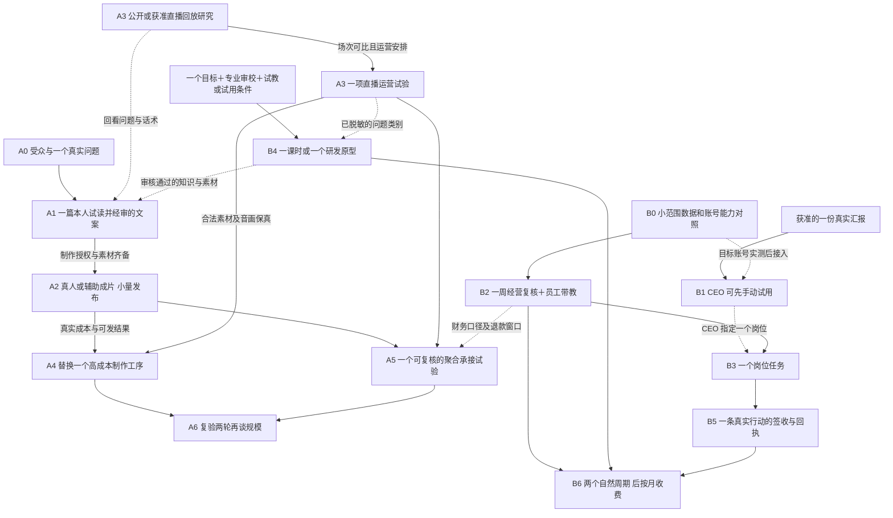

# 澜心社双主线 AI 商业作战地图与阶段量化规划

LXS-AI-BUSINESS-ROADMAP-20261125 · r1 · 2026 年 11 月 25 日（北京时间）  
用途为方法评审、试点排序与合作谈判准备。本文中的样本门槛、工时上限、报价算例和经营情景为规划值，实际订单、成本及授权按相应业务方的原始记录核定。

[文案关口](#copy-review) · [阶段验收总表](#stage-gates) · [甲方收益测算](#client-value) · [我方报价](#service-economics) · [近期行动](#near-term)

## 第一章　商业方向与当前结论

**项目一的优先事项是把一篇合格文案做到本人愿意试读、专业人员能签核、制作人能拿去拍。项目二的优先事项是用一份真实汇报或一张经营控制表，帮负责人作出一个有记录的判断。** 两件事都可以在现有入口完成，分别为下一次真实发布和第一笔可验收的经营服务创造条件。

| 本阶段放在桌面上的事 | 我方先做到哪里 | 希望甲方给出的实际行动 | 第一项可观察的结果 |
|---|---|---|---|
| A1 完成现有文案阶段 | 从已存在的一个稿件及其改稿版本提取差异，做一张试读记录和一页审核依据 | 本人实读一次，专业稿明确审校人，选定准备付诸制作的版本 | 有稿件版本、计时与具体改句，能判断卡在知识、观点、表达还是验收 |
| A3 公域直播研究并行 | 用一场获准回放做时间轴，找出一个能同时用于直播话术和短视频的真实问题 | 运营提供一至两场可比回放或聚合复盘，并说明直播目标 | 能定位哪段留人、讲清了什么、承接在哪里，哪些判断还缺数据 |
| B0、B1、B2 经营能力验证并行 | 用原表做一页经营问题说明，用去标识的真实汇报做一次手动处理 | CEO 指定一位核数人或汇报人，约定一次真实使用与复查 | 收到明确采用、退回或暂缓的决定，拿到员工是否会复做的证据 |

**最值得先谈的三项合作。** ① 按既有范围做完文案试读与过稿，新增短视频样片和真实发布复盘按范围另议。② 把已获准的公域直播复盘做成一次运营诊断，有指定场次和负责人即可先试。③ 先向能核数的人展示一张经营控制表，推荐把 **“一个经营周的对账解释＋一位员工独立复算”** 作为第一笔新增服务候选。若原财务报表已低成本完成，改做真实汇报处理或结营积分收尾。课程研发可提前选题与估算，拿到清晰目标、审核人和真实试教条件再启动。

我方的优势是能亲自把市场、内容、制作、运营与经营证据串起来，再把方法教给承担实际工作的人员。客户只需说日常问题，继续在原文案、经营表或待办中确认结果。全生成视频、原生定时推送、自动化多人流程与跨企业复制，分别在对应阶段拿到样本和经济证据后扩大。

## 第二章　业务、资源和证据地图

证据记法为 **【实】** 本轮或历史的澜心社可复核资料，**【外】** 公开一手来源，**【假】** 决策用样本或经济假设，**【待】** 需要实际测试或甲方补证。用户描述的已开展工作单列为【用户观察】。每个证据只支持它所覆盖的对象、版本、账号和时间窗。

### 已能拿来用的资料

| 来源 | 实际看到的内容 | 可以支持到哪里 |
|---|---|---|
| 001 内容 Brain，公开仓库固定提交 | 【实】读取接手规则、系统地图、观点与表达指南、禁用边界、稿件及变体、视频档案和发布快照。已确认的表达规则按内容意图区分个人成长叙事与专业解释。仓库内可定位到带版本的试读稿及一份微信视频号发布档案。到本文观察时，所抽查的新稿仍显示草稿、待试读或审核，尚缺与之对应的抖音发布证据 | 可校准文案验收、沿用现有流程。一份视频号快照可以演示如何按发布后时点复盘；抖音完播、客资和成交需要抖音自己的数据。 [内容档案规则](https://github.com/lanxichen4134-bit/001-/blob/1b49310d19f28b5e39aa85f05dd3459b87314be6/%E6%BE%9C%E5%BF%83%E5%86%85%E5%AE%B9Brain/Docs/VIDEO_CONTENT_SYSTEM.md) · [项目状态](https://github.com/lanxichen4134-bit/001-/blob/1b49310d19f28b5e39aa85f05dd3459b87314be6/%E6%BE%9C%E5%BF%83%E5%86%85%E5%AE%B9Brain/Docs/PROJECT_STATE.md) |
| 自有内容与剪辑历史 | 【实】既有直播切片验证已产出可供人审的候选。也发生过仅凭 ASR 和视觉标签误判问答及动作匹配，后经复核降级的实例。既有教学短片有本地成片技术记录，观看理解、正式课时归属和专业采用各需对应验收 | 先复用抽帧、时间码、候选索引和失败检查。正式发布前核原音、原意、镜头、字幕及专业范围。见附录证据 E3 |
| 11 月 23 日经营审计 r1 | 【实】已回读 Drive 全文，与本机正文一致。订单与商品归属存在同一退款重复出现的情况。商品行成交额、退款和净额另有算术余差，两条异常行可复算出差异，服务端净额规则仍待核。前周含大促，周差只能作为诊断线索。会议“条数”和“积分点数”需要分开。详细数值和受控复算可由我方负责人复审 | 可做订单周复核和积分收尾的候选案例。财务是否已有控制、真实返工、利润、退款原因与合同范围仍待核。见附录 E4 |
| 现行 Analytics Skill | 【实】项目根唯一活动版本为 2.1。本轮通过本机现成入口用小样本实测，营期定位和打卡列表访问成功。订单、退款排行、商品、课、会议等采用 11 月 23 日已授权审计的聚合证据。频率、历史覆盖独立对账、岗位可见范围逐场景设置 | 现阶段本机可按营查询去标识打卡样本。客户 Chat、Work 的实时读取与计划任务另以各自身份实测。私域直播字段用于私域口径。见附录 E5 |
| 抖音账号与专业协作 | 【用户观察】公域直播在运行，已有账号基础，可协调专业支持与小额实验资源 | 可以马上备问题单、样本及展示方式。真实投入上限、可查后台、账号资质、素材权利、员工时间与独立合同由甲方有权负责人确认 |
| 公共平台、研究、工具 | 【外】平台有单场直播与短视频查看路径，公开医疗科普与运动直播案例可作形式对照。AI 视频工具有公开单价，实得可用率和审核成本须在项目中测量 | 支持选试法和设预算。竞品公开播放、厂商成功案例或研究论文的结果只适用于其样本。见附录 P1–P13 |

### 内容资产直接接在 001 的原流程

一次业务主题沿用一个 **Content ID**。口播、开头或结构的变化使用现有 `variant_id`，制作进度用 `media_stage`。发布由原负责人登记独立 **Publish ID**。后续在相应发布记录追加 **Data Snapshot**，同时保留平台原值、统计时点与AI衍生计算。内容状态沿原链流转，稿件上的技术通过、本人确认、正式发布和市场验证对应不同证据。澜心确认为长期观点或偏好的内容才引用为已确认，原始转写、专业依据、候选解读与 AI 示意各有归属。实际附记回到原档，001 已具备研究入口、共创、归档和复盘模板。 [视频内容系统](https://github.com/lanxichen4134-bit/001-/blob/1b49310d19f28b5e39aa85f05dd3459b87314be6/%E6%BE%9C%E5%BF%83%E5%86%85%E5%AE%B9Brain/Docs/VIDEO_CONTENT_SYSTEM.md) · [正式决策](https://github.com/lanxichen4134-bit/001-/blob/1b49310d19f28b5e39aa85f05dd3459b87314be6/%E6%BE%9C%E5%BF%83%E5%86%85%E5%AE%B9Brain/Docs/DECISIONS.md) · [一句话入口](https://github.com/lanxichen4134-bit/001-/blob/1b49310d19f28b5e39aa85f05dd3459b87314be6/%E6%BE%9C%E5%BF%83%E5%86%85%E5%AE%B9Brain/Docs/ONE_SENTENCE_EXECUTION.md)

### 从市场到复盘的工作与合作机会

| 工作 | 具备的起点与主要缺口 | 对双方有价值的交付 | 先后关系 |
|---|---|---|---|
| 市场、受众及问题 | 001 有受众定位、公开知识与研究路径，真实买家问题和本账号样本仍待核 | 从一个问题样本做证据卡，作为诊断与内容策划交付 | A0 可并行，先给 A1 一个有依据的题 |
| 产品、课程与知识 | 有产品、课程目录和既有内容研究；货号关系、可信原课、成本和学习成果需核 | 课程原型或商品说明验证，有专业审核才扩大 | B4 可前置研究，真实原型按目标与投入立项 |
| 选题、文案与素材 | 有草稿、修改和版本档案。稳定过稿、人审时间与采用率未测 | 一篇可拍稿和可复用验收标准，减少反复改稿 | A1 是正式短视频制作的必要条件 |
| 公域短视频与直播 | 短视频有本地制作基础；公域直播由用户确认在做，账号级数据与可比场次待取得 | 一条真人或辅助成片的反馈、一场直播运营复盘。知识和话术可共用 | A2、A3 各自验收，互为素材来源 |
| 销售承接、私域订单与交付 | 私域有汇总字段与核验案例；公域到私域映射、退款成熟期、成本与履约人未知 | 单一渠道或活动对照、回执和净贡献核算 | A5 与 B2 共享财务口径，落地前由平台与业务负责人共同核 |
| 反馈、复购、经营 | 有打卡和会议来源，可测试员工交接；历史复购队列和客服主题需补 | 一次真实闭环和异常词典，验证后可做周期服务 | B3、B5 首次只进一个岗位，B6 看重复发生 |
| CEO、岗位与专业审核 | CEO 是当前沟通入口。受托人、账号权限、日程、口径核准与审校资源待签认 | 让管理人只看一页关键项，让员工回原工具处理，并用试单界定投入 | B1 手动可先试，B0 接入与 B2 审计可并行 |

## 第三章　项目一的完整阶段规划

下列门槛为【假】试点规则，具体标准随批准的发布目的、样本条件和预算记录。第六章汇总每个阶段的通过、优秀、失败条件与下一步，第八章列双方投入和可收费交付。

### A0　市场、用户和业务基线

- **要证明**一个题对应一个真实问题，并且有足够证据值得策划。现有 001 受众与题库可以提供起点。本账号运营口径和人员成本还需跟着自然任务记一次。
- **最小行动**先选一个明确场景。从已授权汇总、公开专家科普、跟练内容和同体量账号中找证据。计划首轮按专业解释、可跟练／生活演示、同类运营各选一个来源，每个最多审 3 条样本，同时保留低互动或不同意见作为对照。直播另抽至多两场可合法看到的回放。记录公开链接、时间码、日期、可见指标、语言、时长、是否营销。个人经历与健康信息留在原合规环境，报告仅取问题类别及非个人指标。无法取得公开场次时先做样本卡和导出字段表。
- **判断与边界**一个清楚问题须有两种互相独立的证据，并注明最强反例。计划 2–3 个研究时段。出现持续证据单一、目标用户不符或甲方无法给出可信回答时，下调选题。市场图谱继承原题库，采用 `P1` 的公开案例作为观察模板，不能替代本账号需求。
- **业务价值**少做无法回答或无法承接的题，减少搜题和无效试稿。记录合格题／已检题、人分钟／可交稿题以及专业补证次数。一次研究费可验收于一个推荐题和一个否决理由。下一个题的研究继续沿用已有资产。

### A1　什么是澜心社的好文案

- **要证明**同一种内容意图经少量样本能得到稳定判断。目前有已确认的表达规则、现稿与改稿版本。优先拿到一版原稿、一版修改稿和一条原反馈，经本人核实后冻结这轮的主要意图。
- **最小行动**先挑一个已在推进的题，读回观点、依据和表达规则。让本人先用原稿试读，再试经过一项明确修改的稿子。用同一张表分别记知识不准、题目不适合、观点待认领、表达不顺、流程中途转向、验收未定义六类问题。录音机器转写作为定位，本人确认以可回查原声或文字意见为准。专业题由有权人员签核，研究说明放在稿外。下一轮扩大到至少 3 个题、6 个稿件任务，覆盖知识解释与成长分享两类，给每个选题单独选择叙事方式。
- **现场验收**把可拍证据落在稿件版本、核心问题、实际试读用时、卡顿点和审核意见。同一版本能够被制作人按口径拍摄，才进入 A2。样本小但有一篇已获准，可以先做一条；批量质控仍看至少 6 个任务的首轮通过、修改轮次和全部人分钟。优先测本人审核用时有无下降，以及能否保持事实与表达质量。第五章列了按目的选择的评价标准。
- **投入与退回**我方负责研究、改稿理由、计时与交接，甲方提供当前版本、本人至少一次试读和专业审核人。连两轮用同一目标仍无法确认观点时，回到观点核实或缩题。现有交付按已约范围收尾，另议新增拍摄、发布实验或持续共创。可复用资产是一张能解释为什么退稿的评价表和经允许抽象化的反例。

**为什么这样判。** 001 可回查的专业口播改稿把概念解释、拍摄提示、未核材料和专业审校放在可分别复核的位置。个别早稿需要更清楚地说明观众接下来能做什么，改稿仍保留待试读状态。另一类原创成长题已有逐段依据，同时标注新增情境和对白的性质。眼前应该验证的是本人会不会这样讲、观众第一遍能否听懂、哪些句子专业人员能签，而不是先判断知识库整体是否要重做。

### A2　短视频生产、发布和反馈

- **启动**一篇符合 A1 单条放行条件的脚本、一名制作责任人、明确的账号及素材权利。可以先做真人＋人工剪辑基线。生产验收后，在甲方允许的账号小量发布，并为每次发布追加独立快照。仅开展研究时可以拿同条件旧片做离线基线。
- **最小试验**先在同一题用常规制作和 AI 辅助各做一版，评审看原稿保真、音画、时长和首遍理解。总制作试验 4 个任务，第一条通过即排一小轮发布。市场比较用同账号、同意图、相近时长、相似自然与付费分流，至少 2 对可比发布。每条计划记发布后 24 小时和 7 天的快照；看不见的数据留待补证。一次只改开头、时长或剪辑节奏其中一项，试验前选一个主要指标。公开播放只能支持其可见口径。
- **选择路线**先以原人工为成本对照，再用 AI 做字幕、候选片段和包装，真人口播保持原声。有授权直播段落可做独立切片。授权数字人口播、AI 配音及场景生成采用离线小样，审核声像授权与失真。完全生成安排在 A4 专项测试。
- **继续或退回**成片要能无提示让试看片者复述主旨。完整成本包括制作、验收与失效件。发布未经确认、素材权利不清、内容硬伤、理解变差时退回前一步。采用相近工序证据争取一个新制作版本的实施费，再用独立快照决定是否继续。

### A3　公域直播研究与运营改善

公域直播属于项目一。**只读研究与 A1、A2 同时启动。** 甲方许可实施前，先选一个目标和一项可以当场讲清的运营问题。优先看已开放回放和甲方主动提供的单场汇总。

| 直播动作 | 当前最省的起步 | 何时升级 |
|---|---|---|
| 播前研究、脚本和知识 | 我方看两场回放，标首 2 分钟、一次完整讲解、一次问答、一次承接。从原选题库抽一个问题，给主播一张话术卡、专业边界和能回查的依据。先量准备和审核人分钟 | 多场反复找同类答案，原资料能维护时，考虑由 ChatGPT 查找已批准的话术 |
| 场中信息 | 运营原工具按场次填流量、主要问题和变动时间。规则只提醒缺字段，主播与运营负责实际处理 | 首先验证人工提示有实效、不会分散注意和误导。确有低延迟需求，再评估后台授权及开发 |
| 场后复盘 | 对齐场次、同一分母、流量、商品、促销和售后窗口。规则先算进房、停留与交易，ChatGPT 将一项差异写出可能原因、反证和下一场的一项变更 | 达到连续可复算和负责人真正使用后，再评估定时汇总或自动读数 |
| 切片与复用 | 从原时间码核真实问题、回答、动作及上下文，选一个能独立成立的片段，接回 A2 与 001。同一主题的话术与短视频可共享证据 | 两轮均有可采用素材并减少全程回听工时，再进入 A4。缺听审时只保留候选 |
| 数字人或生成式替代 | 先用真人为真实基线，离线看许可、声音、动作、信任、平台政策、审核与成本 | 有账号资质和发布许可后才考虑受控试验。质量、用户理解与商业反馈均可复核才扩大 |

**场次试验。** 预备 2 场同目的基线与 2 场可比观察，最早只对一项安全可逆的变更作对照，例如提前回答一个常见问题。记录开播位置、主播、主货、投放和促销，固定与直播目标对应的主指标。知识直播先看内容被听懂、同窗停留或可复述问题。带货场次另核商品曝光、点击、成熟后净额及退款。场次混有公域和私域、平台账户不明、没有独立指标或无法保持主要变量时，只给描述性复盘。本轮可核的是公开行业案例与指标规则，澜心社该账号的场次实物和后台基线待取。客户给出一名运营和真实回放，才安排有限运营试单。

### A4　把 AI 剪辑与生成用在可证明的成本上

优先用 AI 找片、字幕和辅助包装。单独测通用生成镜头、授权真人数字人或声音、专业解释图示与整片生成。准入证据为 A2 或 A3 已测到具体工序成本，及可供对照的同类任务。计划两小批，各最多 4 个尝试，保留失败、弃片、素材许可和审核记录。只观察成功片段会低估返工。

| 制作方法 | 哪类工作最合适 | 实际比较与退回条件 |
|---|---|---|
| 真人实拍＋人工剪辑 | 核心信任、本人表达、专业动作连续示范 | 取同脚本或难度相当原片，记从拍摄到可发的完整人时与成本 |
| 真人＋AI 剪辑 | 重复字幕、转场、初选素材和静态包装 | 以原音、动作、时间码与人审为准。误认问题、错动作或缺语境时退回人工 |
| 直播切片 | 一段本身能回答一个真实问题，另可有重包装路线 | 分开统计有完整问答的原生片、只适合编辑的素材池与弃用。按每场完整查找和听审除以最终可发条数 |
| AI 图像、画面或语音辅助 | 通用 B-roll、已核解剖示意以外的辅助解释、可授权配音 | 并入真人链工作量。逐项查素材权利、说话人授权、字幕与声明，场景可保留人工替代 |
| 授权数字人口播 | 平稳、结构短、可监审的候选 | 用真人口播盲测理解与信任，核资质和账号发布规则。口型、音色、身份提示或事实出现问题即停 |
| 完全生成 | 先测试一段非高风险、可替换的短素材，再评估连续成片 | 多段可用性、人物连续性、事实准确性、人审、整片成本和两轮重复是扩大投入的证据 |

本地工具可将标准化动作技术检测做得很细，仍需业务人员看懂和签核。阿里云北京区域的万相 `wan2.6-i2v-flash` 720P 有声官网价为 **0.30 元／输出秒**，无声 **0.15 元／输出秒**，参数文档给出 2–15 秒。HeyGen Avatar IV 的 Photo Avatar 官方列 **2.31 美元／分钟**，按实际生成秒计的适用情况见定价页，直播头像另有计价。已生成但不能用的输出仍可能计费，失败请求及重试的费用按具体产品规则，等待、人工与素材成本照录。体验、订阅、跨地区与税费以实际账号为准。[万相模型资料](https://help.aliyun.com/zh/model-studio/wan2-6-i2v-flash) · [万相图生视频参数](https://help.aliyun.com/zh/model-studio/legacy-image-to-video-api-reference/) · [HeyGen API 官方价格](https://help.heygen.com/en/articles/10060327-heygen-api-pricing-credits-explained)

### A5　公域、私域与销售归因

- **最小条件**甲方同意一项允许的承接动作，公域运营与私域核数人达成同一窗口、来源标签规则、退款观察尾巴及重复对账定义。优先使用平台自带的商品／活动归因或匿名聚合活动代码；单纯相同日期、商品名、销量时点只能比较趋势。
- **验证**以内容 Publish ID／直播场次为上游，记录曝光、进入、商品曝光及点击、合资格客资、已支付、后续退款与净实收的各自覆盖。短视频与直播的归属窗口各自保存。一次选单品、单来源、可回溯入口；控制活动和自然变化。财务负责扣跨期退款、组合归属及重复计入。健康科普和商品经营按资质、平台和宣传政策分开设计，承接仅对获准且适用内容。
- **判断**一条渠道能出聚合控制表即可开始最小试验。只有交易与费用均按约定到期核准才能报告增量贡献。无对照时可验收记录链和阶段行为，保留经营因果未知。甲方从中获得是否继续投放的依据，我方以归因诊断、对照设计与复盘收费。

### A6　以真实反馈重复一轮

每轮先固定内容或直播的一个目标，明确这一轮只变什么、对照范围及记录人。用两轮完整记录验证能否连续出现可复算且可行动的结果。留存被排除选题、停投或回到人工的反例。至少一位客户同事能接住复盘，并将确认的素材或话术更新到原入口。只有质量稳定、单位成本与维护工时经过复测、双方都能从下一轮获得价值，才增加工具预算、视频数量或月度服务范围。

## 第四章　项目二的完整阶段规划

### B0　先验证业务问题能否在一个入口答对

**当前起点。** 本机可用已安装的只读打卡入口。前轮经营审计已实读取景所需的订单、商品、课、营期和会议。新账号的发布、安装、后端工具、身份、数据和计划送达各有自己的回执。CEO 发一句业务问题后，后台先识别所指对象、统计截止、角色权限与字段来源，再用固定计算得出摘要。遇到同一期号多个营，按营名、日期列示，必要时只追问指的是哪一个。计划先让一位获准使用者在实际账号里复现一个受控答案。当前可以用获准的汇总材料验证答复样式。

| CEO 日常问题 | 后台拿什么和怎样核 | 给她看到什么 |
|---|---|---|
| “这周有哪些变化值得我管？” | 截止日、财务确认的对照周、三个销售标签及两张控制表。订单级与商品归属先核勾稽 | 最多三项，说明比哪天、差在哪一步、要谁核、只要我决定什么。无显著变化时给一句汇总 |
| “这个营昨天打卡怎样？” | 营号、班级、业务日、应到口径、实际去重人数、更新状态 | 一张营级表，列分母、是否结营和缺字段。早结营或未同步分别提示 |
| “帮我先看下面人的汇报。” | 允许使用的一份去标识报告、形成日期及证据位置。读取范围按工作职责授权 | 已确认结果、困难、待决项、原负责人及跟进日期，原始汇报保留位置 |
| “把上场会议的积分问题列一下。” | 取同一场次的会议列表与积分汇总，条数、点数、审核状态和最后同步分列 | 给原负责人一个核查清单，金额、实发及处理结果由其授权入口确认 |

**接入试验。** 在目标账号做 3 道已知答案的正例（订单控制、运营聚合、汇报摘要），以及过期数据、越权、缺分母各 1 道。用原系统快照核时间、范围、相等项和未知项。对 CEO 与受托人分别核授权，限制查询对象与返回字段。只要当前在原工具中的手动导出能跑完一个业务判断，B1 就可先开始。重复搬运影响使用时，再做 Plugin Creator 或相应支持的连接入口，先验自然语言发起、再验后端调用、最后验该账号的实际可读结果。

### B1　用一份汇报检验 CEO 工作提效

| 日常环节 | 一句日常用语及真实对照 | 启动到采用的最小动作 |
|---|---|---|
| 每日或周期经营简报 | “今天哪些事需要我决定？” 案例选一个重要变化、一个数据缺口与一个已决事项 | 先由本人在有真实事项的 5 个工作日内主动打开，最多一页。日频或周频以实际出现的决策数量决定 |
| 员工汇报预处理 | “先替我把这份汇报理清，原始证据能打开。” 对比 CEO 原读时长、员工整理和复核 | 把事实、员工判断、已做、卡点、待决和下步分列。员工核日期与状态，CEO 只决定需要她处理的问题 |
| 想法整理 | “记录这个想法，今天这项交付照原约定完成。” | 把想法、研究候选、已有范围变更、待决及确认行动放在原有待办字段中。变更由有权负责人确认 |
| 决策及执行反馈 | “上次定的那件事，谁已经接了？” | 输出决策日期、负责人、截止、接手凭据和验收结果。原负责人核实后在原工具更新 |

**定时简报分两步验。** 先证明 **她会读、会判断、愿意再次打开**。之后再检验从任务生成、授权时取数、失败提示、去重与更新时间，到通知送达、对方看到和采取行动。OpenAI 当前帮助中心将自定义 GPT 列为 Scheduled tasks 的不支持项，同时说明部分计划任务可用已连接应用，事件能力取决于账号与工作区。由此可设计普通聊天、定时任务及支持的应用三条各自验证的路径。具体 Plugin Creator、计划触发和通知在甲方账号能否串通仍待实测。候选顺序为手动提问、获准的受控定时汇总、符合实际权限的通知。送达记录只证明送达，采用用人员回执确认。实施前要有明确收件人、北京时间窗、内容范围、失败转人工、易停用方式和运维人。 [ChatGPT 定时任务](https://help.openai.com/en/articles/10291617-scheduled-tasks-in-chatgpt) · [ChatGPT 插件及权限](https://help.openai.com/en/articles/20001256-plugins-in-chatgpt)

**试点。** 先取两个相近的真实汇报作为一对对照，再扩到 10 件自然汇报。记 CEO 阅读与决策、员工准备、核数、返工、人机等待分列。质量底线是重要事实错误 0、没有把未签收写成完成。继续条件为独立使用与总人时改善持续出现。交付一页真实结果、一条无需技术词的问法与一次复测，现场看不出用途时保持按需查看。

### B2　持续找值得经营负责人处理的问题

1. 每个经营周先冻结时区、窗口、业务时点、对照组、退款截止、金额单位、场次与商品范围，保留控制总数。优先对齐财务原表。
2. 分别查看净实收、退款、同渠道商品及授课交付。对退款等异常给出“原来看到什么 → 去重或口径校正后看到什么 → 谁能解释 → 一个最小动作”。商品分项、运费、组合归属和整单总计分别看。遇到近周大额单、活动或大促，用留一或同类型周反证。真实余差和重复展示留受控证据，业务根因由负责系统和财务的人核准。
3. 首购、复购按相同合格首购规则、客户去重键及同长成熟窗口计算，付款数与人数各有分母。课／营参与按应到、状态和业务日解释。会议只把状态差异列入核查，点数与条数分开。无权或不齐的数字写清影响。
4. 每周只交一个会改变决定的理由和一个可撤回试验，记录原操作、改善成本、核数人、继续或停止的证据。先试一个完整经营周，员工下一轮独立复算。若原财务已理解并控制同一差异，复用原流程，是否收新费由范围和真实新增成果决定。

这是第一个新增服务候选。它以解释一个真实差异、交一张控制表、完成员工复算为验收。能否获得实际增量贡献还需之后的试验。

**展示用算例【假】。** 一笔组合订单实付 140 元、整单退 140 元。商品行分别分摊成交 80 和 60，各行却展示整单退款 140，两个商品净额显示为零。商品行退款的简单和是 280，而订单实退为 140。商品行的“成交减退款”是 −140，与显示的净额之和 0 又有 140 的算术余差。财务可用去重后的订单级控制数核收付，同时向系统方问清商品行是否同时展示全单退款与分项净额。近期营业问题先按经核口径处理，算例的差额没有可直接兑现的现金价值。

### B3　进入一个岗位的原工作

以下角色是拟议责任位置。实际频率、原工具及全人时按一次现场对照查明。选一个岗位，以两对可比任务测原流程和辅助流程，再决定是否增加样本。共同记录原材料、证据、责任人、错误、人工时间及接回原工具的结果。涉及个人服务时采用原授权入口和必要的聚合或删敏内容。

| 岗位候选及触发动作 | 原工作、重复与可检验的成本 | AI、人工与回执 |
|---|---|---|
| 销售支持，商品或活动变更 | 找近期商品说明、权益口径、客服答复，容易多处核对 | AI 从已确认资料写一页变化。商品负责人校对，在原销售说明替换对应版本。量一次准备和答复复查 |
| 公域运营，一场直播结束 | 对齐主播说法、数据和话术改动，再交剪辑 | 固定表算汇总，AI 写一项差异和时间码。运营与剪辑分别确认可用，量复盘与二次沟通 |
| 班班／助教，日报或交班 | 同号营、补卡和历史记录易从截图读错，例外判断需追原账 | 按营号和业务日比对，以聚合提示交班事项。班班在原表复核缺项，量重复查表次数和纠错分钟 |
| 教务，课程节点或结营积分 | 核场次、同步时间、待审和已发，需要分清单位 | 先用规则产生核查清单，再让 AI 解释字段。审批人确认例外，记录接手结果和人时 |
| 客服／社群，反复出现同类疑问 | 查已审话术、分辨需转交事项，返工和投诉升级时间待测 | 已授权的问题类别引用现有答复及转交条件，人员在原系统处理。只记录解答是否准确和后续转交 |
| 内容／课程团队，一篇稿或一个小节到审 | 查来源、专业口径和已有相似稿，重复检索与改稿 | 汇总可追溯依据，输出差异、复用版本和待核句。专业审阅者确认后回原稿，量人审及返工 |
| 财务／经营核数，周内金额需要解释 | 同时看汇总、商品和退款，不同分母可能导致重复资损判断 | 规则控金额，AI 写一页差异解释。财务签核或驳回，在原周表登记。有更省工的原报表就沿用 |
| 管理助理，一个真实待办需要交接 | 从会议、汇报和聊天反复找负责人、截止及承接 | 生成可溯源的一条待办，接收者实际确认后记完成。量遗漏、退回和追问次数 |

第一优先可用结营积分与日报做小试，因为有同号营、日期或单位错配这样的可核案例。若企业没有相应人工动作或现有规则已经解释清楚，转到真实汇报预处理。取得一位员工独立完成及负责人确认后，才增加培训岗位。

### B4　产品和课程研发分别过关

**共同起点。** 我方先把真实用户问题、现有替代品与拒绝理由写成一页。最低条件是甲方给一个负责人、一种可触达的目标用户、一个预算上限、一名合格审核人和实际测试位置。先从获准材料中抽查约 5 个实际问题或场景，至少保留一个反例。口头有兴趣只作为研究信号。优先选能实际展示和审核的原型。

| 研发步骤 | 课程的可验证交付 | 实体商品或服务的可验证交付 |
|---|---|---|
| 确定目标 | 写给谁、学完能做的一个动作、初始表现和合格作品 | 写具体用户情景、主要用途、现有替代、可观察的改善和无法承接的需求 |
| 选资料、拆单元 | AI 对候选资料做来源表和共识／争议对照。专业负责人核准确性及适用范围 | AI 比较公开规格、已有说明和合规档案。甲方核规格、成分、供应商、合规职责与引用权 |
| 设计最小原型 | 一个 15–25 分钟的计划示范单元，一个练习与可见成果，配一个前测和同难度后测，如能否区分事实、推测及需要咨询的内容 | 先用说明卡、纸样、已有产品的合法使用说明或非功能性模型。需要新零件、身体接触或功能声称时，交供应链、检测与专业合规评估后再做物理样品 |
| 小规模试用 | 约 5 位同意参加的目标学员先试一个主题。让他们独立完成新情境任务，记录达到标准人数／被分配人数、未完成、误解和用时 | 约 5 位同意参加的目标使用者对照现有替代，完成一个可观察动作，记录误解或退回，验证可用性而非意向问卷 |
| 定案及商业门槛 | 专业审校通过，任务与评估对齐，后续观察能否迁移到另一个同类问题。再核讲师、服务、实际定价、交付能力与课程贡献 | 原型被理解且供应商报价、抽样、材料许可、检测、生产、库存、售后及合规责任清楚，才能给上市小批量预算 |
| 如果失败 | 首先改目标或练习，退回一节，不急于重做完整课程；健康主张待核则采用低风险知识识读题 | 用户在可比环境更偏好现成方案，或原型的固定成本和售后吃尽贡献时，留下验证证据，放弃新开发 |

量化从研究、专业审核、原型到试教／试用逐人记录。给不同任务使用同一评价尺，首轮通过比例为“专业和任务均过关的可用产物／全部交审产物”。课程用行为作品和新题复测观察学习效果，满意反馈与课程净贡献另记。研发时长缩短只是过程指标。若要体现利润，须补供货、检测、交付、退款、流量、佣金及正规售价。本阶段可售的是受控研究、有限原型、审校准备和试验设计。 [课程目标、活动与评估对齐](https://www.cmu.edu/teaching/assessment/basics/alignment.html) · [先检验真实用户任务](https://www.gov.uk/service-manual/service-standard/point-1-understand-user-needs)

### B5　用同一条真实待办验证组织协作

在一个原有例会或交班里选择一类待办。目标由业务负责人定义，会议以前得到材料和需决定事项，会上按核准口径生成决定、负责人、截止与交回条件，会后让接手人在原工具签收。AI 抽取和标注矛盾，员工核事实，负责人作出经营、用人、薪酬和专业决定。首轮选择 5 个决定，保存来源、是否接手、遗留问题；延伸检查计划合计 10 个决定和两次自然会议，比较未签收、逾期未说明以及反复询问。员工填一项就够时用固定表，若回执习惯还没有形成，先由主持人把一条决定交到位。

### B6　把有重复价值的服务写入月度范围

以两个无重复计费的实际周期作候选。甲方拥有原资料、角色权限、结论定夺和停用权。我方月末交一页经营异常、已处理问题、采用证据、下周期一个建议和工时账。可以由客户自行完成的表格和规则优先教会其使用；定期复核、维护、权限异常和新增试验按约定服务量计。推荐报价拆约定维护与下一项改善，范围、响应窗口、纠错次数及续费标准写在服务单。只有被反复使用、可回收工时或可核收益覆盖费用时增加服务量；无输入、无人用、每次都靠我方代做或重复越过预算，就降低频率或结束。跨其他企业之前先在两个同类单元验方法能迁移，再使用获授权的空白模板与匿名算例。

## 第五章　什么才算好

### 文案分六层验收

| 层级 | 必须看到的东西 | 谁判断 |
|---|---|---|
| 专业合格 | 每个必要主张有出处与适用范围，区分医学证据、文化解释、个人体验和 AI 示意。专业风险、资质、授权与平台条件逐条通过 | 指定专业审核人、账号负责人 |
| 本人愿意采用 | 本人确认核心观点及具体稿件版本，可以指出改了哪项表达。长期风格确认仅在其原适用范围有效 | 澜心本人或获托审核人 |
| 可拍或可播 | 真实试读标用时、卡顿与理由。一句话能说清观众的问题和带走什么，制作人可按镜头或话术完成 | 本人、制作或直播运营 |
| 市场有效 | 同帐号、相似受众条件、时长组和同龄数据快照。试点主要指标按目标选一个，小样保留绝对数与负面反馈 | 运营、试看片者 |
| 商业有效 | 预先定义的渠道动作、交易与退款窗口、来源标签、对照和完整成本均可回查 | 财务及业务负责人 |
| 能重复生产 | 至少两个批次、不同题目仍通过，第二位制作人或本人能按原表复做，完整人时可核 | 原工作负责人及真实操作者 |

**硬门槛先判，表达按目的评。** 任何关键专业错漏、未经允许的经历或声像借用、伪造原话／反馈、身份及合规边界不符，相关版本退回核准来源。其余用“通过／改一处／重做”判定，无需平均打分。专业解释先看 **是否尽早回答具体问题、解释准确易懂**，再看口播、密度和一个可理解的下一步。成长分享先看 **真实生活场景、本人观点怎样自然形成、听者能否跟上**，再看节奏与品牌差异。商业说明先核 **受众适配、规格、权益、价格与当前规则**，再看自然表达和行动入口。好的开头让人认出自己的处境，正文回答开头的问题；停顿或铺陈有其作用。每稿只选一个主目的。凡引用本人观点，记录对应 Brain 条目或本人这次确认；未核的机器转写与原创情境留在依据区。 [001 研究报告标准](https://github.com/lanxichen4134-bit/001-/blob/1b49310d19f28b5e39aa85f05dd3459b87314be6/%E6%BE%9C%E5%BF%83%E5%86%85%E5%AE%B9Brain/Docs/RESEARCH_REPORT_STANDARD.md)

### 短视频、直播与企业工作如何评

| 成果 | 合格的可观察证据 | 值得扩大之前再看什么 |
|---|---|---|
| 好短视频 | 手机可辨字幕、音色和关键信息，字幕画面与说话原意相符。一个未经解释的真实观看者能复述核心观点，专业表述通过 | 计划小样 5 人中至少 4 人复述主旨，严重误读为零。真实发布的主指标提升有同条件对照，质量保持、失败及返工计入有效成片成本 |
| 好直播内容及运营 | 有清晰场次目标、可回查的话术和重复段落。观众在任意进场段落知道在讲什么、怎么参与，专业和商品表达由授权人员复核 | 两场可比试验的目标指标与负面信号均可解释，运营能单独复盘。主持安排、投流、价格、货品变化有记录。健康与商品条件见 P4 |
| 好经营简报 | 以截止日和来源开头，区分事实、未知、异常和待决，能由负责人回到原表重算，重要数据错误 0 | 在两个自然周期内产生可以核对的决定，每个决定有负责人和反馈，阅读与准备合计人时有改善 |
| 好 AI 工作流程 | 常用请求一句话发起，身份和口径受控，未知可解释，人工能接回原表且能纠错和撤销 | 第二位操作者不靠我方代做就达到同一质量，支持负担落在约定容量内。审批、发布或修改留原权限人员 |
| 好产品研发成果 | 有真实问题、一个可验证用途、已列替代品和验证原型，专业、材料、供货、安全与合规可核 | 试用结果、单位成本、固定投入和取消条件同时成立，先检验量产或推广的可回收性 |
| 好课程研发成果 | 学习目标、活动、练习成果、评价尺彼此对齐，专业审核签字，试教结果可复查 | 在新问题中仍能完成目标，讲师能复用，真实交付成本及学习和商业回收都有证据 |

## 第六章　各阶段启动与验收总表

表内门槛与样本均为【假】，用来决定是否多投入一轮。只要满足启动栏，就可以开始该栏所指的最小动作。市场基线、工作全成本与甲方使用频率目前为【待】。首个小样允许比阶段样本少，但扩大之前需达到完整验证范围。所有试点都要记录原始来源、版本、审核人和反例。

### 项目一

| 阶段 | 启动及最小交付 | 合格与优秀条件 | 失败、降级与下一步 |
|---|---|---|---|
| A0 市场与基线 | 选一个目标受众场景和一个内容目的。用至多 9 条公开样本及已有授权资料做题目证据卡 | **合格**一题有两类独立来源、有反例、专业范围明确。**优秀**一名原运营能在当天确认题目和可比输入，录下一次真实研究／制作基线 | 两个短研究时段后仍为同源热门或无可答范围，换场景。取得一个可研究题即可送 A1，同时开 A3 只读 |
| A1 文案 | 一份原稿及修改意见、一个受众、一个目的、本人确认入口。先试读一版，再累计至少 3 题、6 项真实任务 | **合格**单条 0 硬伤、本人同意该版、试读可完成，允许送 A2。观察整阶段时首轮通过 ≥4/6、最终通过 ≥5/6。**优秀**首轮 ≥5/6、最终 6/6，来自至少两类内容，完整人时较同难度基线下降 ≥15% | 连续两次退回都在重新定义核心观点，先冻结目标与签核范围；专业错漏未清退回资料。以 6 项版次记录、本人确认与时钟为证 |
| A2 短视频 | 一个合格稿＋权利、账号和制作人。4 个制作任务做可复查对照，先放行一条。发布观测至少 2 对、24h 和 7 天 | **合格**可发布成片 ≥3/4、无严重误读，单条完全成本在原方式的 105% 内。**优秀**4/4 可发，成本降低 ≥15%，两对真实发布的主要指标同向且护栏满足 | 同条件数据缺失时只报生产质量与工时；市场指标转弱、投诉或核心误读则恢复原版本。保留真人基线，市场和制作分轨决定是否升 A4／A5 |
| A3 公域直播 | 获准看一场回放可做解构，有两场已采可比基线与运营人再试一项变更 | **合格**抽 2 场基线＋2 场测试，场次、分母与退货窗口能核，负责人认可一项可执行调整。**优秀**两场同向达到预先约定的最小有意义改善，且完整总工时下降 | 无法合法取数只交话术与复盘框架。流量、活动、货品同时变化时单列差异，延后归因。经审核的真实切片候选接 A2／A4 |
| A4 剪辑／生成 | A2 或 A3 有真实工时、源材权利、人工基线，选一个工序。两小批共最多 8 个尝试 | **合格**同类合格素材达到最低制作需要，初始规则为 ≥3/8 并且完全单位成本不高于人工。**优秀**≥4/8 且成本低 ≥15%，两批均通过。整片另核最终可发成本 | 有一项身份、动作、专业或规则硬伤即退回人工辅助。素材测试通过再去做一条完整生成成片，完整发布和收入仍按 A2、A5 核验 |
| A5 销售归因 | 有一个合规标记、两个授权范围和冻结的收入成本口径。先用一笔或一个聚合控制数核规则，再做同窗对照 | **合格**能解释同窗控数、重复及未知归因，等退款窗口成熟后核对贡献。**优秀**至少两轮改进均可回算且扣服务费后对甲方为正 | 缺标记时仅看阶段行为与生产效率。或新增流量与售后成本超过贡献，暂停投放并保留已核来源。可回滚的一项明确措施才送 A6 |
| A6 营销复盘 | A2 或 A3 已有一次真实回执，一个负责人和一个可改变量；约 2 个自然复盘周期 | **合格**两轮各完成一次复盘，有下一次可撤回行动。**优秀**两个独立周期重复改善并覆盖完整成本，客户可独立执行 | 无真实反馈、长期靠我方代做或理解下降时退到单次服务。两条线的采用与收益分别核准后再扩产 |

### 项目二

| 阶段 | 启动及最小交付 | 合格与优秀条件 | 失败、降级与下一步 |
|---|---|---|---|
| B0 数据入口 | 一位授权使用者，一项真实问题，一个可对照原表。先做 6 个已知场景 | **合格**6/6 的回答对上控制数或正确保留边界，越权返回 0。**优秀**隔一周期同一配置复验 6/6，两位授权角色独立发起 | 身份、更新状态、筛选或分母不符时暂停连接，退回手动汇总。按需基础通过可送 B1／B2；定时核验单列 |
| B1 CEO 工作 | 一份真实汇报与原审批人；先做一对，后跟 5–10 个工作日内实际出现的 10 件 | **合格**严重漏错 0，至少连续 2 次自然使用，合计净人时为正。**优秀**10 件中 ≥8 件无需我方代操作，追问下降和总人时下降 ≥15% | CEO 阅读变快但员工与审核投入吞掉节省时改原表；无自然重复保持按需。获批后再做目标账号的一次计划送达和回执 |
| B2 经营发现 | 一个经营问题、一个核数人、一周可复算数据 | **合格**控制数勾稽或每个未解释差额有责任人，至少一项真实决策。**优秀**第二周员工能独立复算，并有一次可归责的行动反馈 | 财务原报表已做完，缩为一次解释或改做 B3。单位、全窗、组间归因或口径冲突未解时不报现金收益 |
| B3 岗位提效 | CEO 安排一名员工和复核人，选一类原任务。先留两对计时，最多再观察 10 次 | **合格**0 个影响客户权益的错误，员工独立完成两次，完整人时不升。**优秀**获得两批同类记录，准确性保持，净人时降低 ≥15% | 若原表规则可解决即用规则。出现权限不足、漏项或返工上升则退人工，积累可用词典。通过一个岗位再谈扩岗 |
| B4 产品与课程 | 一个可接触目标对象、一个负责人、一名合格审核人和原型上限。2–3 周候选窗口，先一单元或一原型 | **合格**专业及合规底线通过，样本中 ≥4/5 能完成一个定义好的任务。**优秀**后续新情境同样达标，研发人时下降且实际交付预算可核 | 单元试教失败退到一个学习目标；实体测试缺供应链、许可或可追溯检测条件则停上市环节。下一阶段由业务负责人签立项 |
| B5 管理交接 | 一个会后行动和可签收位置，观察 2 次会议及 5–10 条决策 | **合格**责任、截止、交回证据正确率 100%，至少一次实际签收。**优秀**10 条中 ≥9 条按约交回且重复追问下降，未交回项有原因 | 无真实承接、结果错置或用来做未经确认的人事判断，回到原表人工核准。决策者认可并自然重复再谈 B6 |
| B6 周期服务 | 上述至少一个流程已有可重复证据，已约输入、周期、人员和费用，试 2 个自然周期 | **合格**两次按时完成并获采用，我方全成本可回收、客户收益或质量价值可验。**优秀**客户第二次可独立操作且产能、费率均覆盖长期支持，复用给同类岗位仍通过 | 输入、使用或收益连续两期不足就降低频率、改为一次性服务或停止。跨客户复用须有可再用授权与在新环境复验 |

## 第七章　甲方怎样计降本、增效和增收

### 指标定义和原始记录

| 要回答的业务问题 | 公式、统计对象和取数频率 | 现有基线或最便宜的补法 |
|---|---|---|
| 文案是否更稳定 | 首次通过率＝第一次交审即按冻结标准通过的稿件任务数／同期全部首次交审任务数。最终采用率＝获明确确认采用的任务数／同批全部已提交任务数。未决列单独数量。修改轮次＝累计有实质改动的回合数／交审任务数。专业错误率＝存专业硬伤的任务／同批交审任务 | 【实】有稿件和变体，无稳定通过基线。前 2 份同时计全部参与者人分钟、本人审核和碰到的退回，累计 6 项后看第六章 |
| 一条视频花多少钱 | 总成本＝研究、拍摄、剪辑、复核、沟通及返工人时×角色费率＋素材、生成所有计费秒、工具、存储、支持。有效单位成本＝全部尝试总成本／同批符合发布质量的成片。可发布率＝可发布件／全部制作任务。观察制作到完成的日历时间、人工参与和失败件 | 【待】真实时间、现金额和可发分母。短视频和直播切片分别取四件成片或相当原工作。失败批未产出单位成本为不适用，实际开支照计 |
| 短视频有没有真实反馈 | 同一账号按目的、时长、自然／投流分组。在 24h、7 天留原值。简单均看秒＝同口径总观看秒／平台记录的播放次数。完播及有效观看优先取后台原字段，导出时保存平台定义，如后台确以有效播放为分母，再用“完整播放次数／有效播放次数”复算。自算的互动每千播放＝点赞、评论、收藏、分享次数按提前约定求和／同窗播放次数×1,000。分子是动作次数，可能来自同人 | 【实】已有视频号样本，可验证记录结构。抖音全量观看、完播和客资【待】，最小试验两对各取同龄快照。缺原分母时只记录后台显示，不拼接别的平台。见 P2 |
| 公域直播问题出在哪 | 按电商罗盘达人版的拆解，看场次时长、单位小时曝光次数、曝光至观看率（次数）、千次观看成交额；同一归因范围内，直播成交约等于前 3 项相乘再乘千次观看成交额／1,000。人均停留用平台明确定义的观看时长与人数口径。商品点击率与点击到支付率均保留后台分母，尤其区分人数和次数。每场保存实时及约定结算快照，促销场另组 | 【外】罗盘有这些字段与链路；【待】客户账号角色、实际字段及同场基线。先拿 2 场同目的聚合，不拿私域 Analytics 的“直播”替代。公域千次成交为通过平台的交易强度，不能代作净贡献。见 P2 |
| 客资、复购和退货能否归因 | 合格客资／同窗合法可观测的落地或咨询入站数，去重规则先写。仅用成熟窗内可比、经核已付款并扣退款的订单。退款金额率＝同期同定义的退款额／合格支付额，订单退款率另按去重发生退款订单／同队列合格有效支付订单。复购率＝完成后续有效付款的去重客户／成熟且有资格首次购买的去重客户 | 【实】私域订单归属和退款窗口的试核有依据；【待】正式财务、成熟退款、跨域归因、成本及人群定义。第一步用一个活动标记的聚合归属，不收集不必要个人资料 |
| 管理者和员工总共省多少 | 每件完整人时＝准备＋原操作＋重查＋审核＋返工＋交接＋支持。净人时＝可比任务数×每件原总时减辅助总时，再扣首次配置和公共维护。使用率＝实际用过的自然机会／本来有资格使用的自然机会。独立完成率＝无人代操作且合格的任务／全部安排试用任务。交接闭环率＝到期前有验收回执的任务／到期全量任务 | 【待】角色和时间。先跟两件自然任务。质量看重要事实错漏／应核重要事实数，偶然一次可用只作为首例，另记员工新增准备 |
| 产品与课程研发价值 | 完整研发周期按开题冻结到该版签核；人时按研究、原型、专业审查、返工、试教、回访分开。可采用成果／提交成果，试教达到目标人数／全部安排试用人数同时列失访。单位贡献＝净售价−产品或交付增量成本−佣金获客−新增售后 | 【待】实际研发时价、许可、学习对照、商品成本。先给一节课或一个说明原型记全程。没有学习成果或销售基线时只报过程/理解 |

**记账规则。** 人分钟、现金、处理量、返工和风险是五项，不相加。甲方可核现金降本只记已减少的账单、外包或加班，扣新增工具及运行支出。时间释放可供重新分配，按同角色费率可另给产能价值估算。增量净实收要同窗扣实际退款。增量贡献核新增货品、履约、推广、佣金、售后、被替代商品和额外人员成本，再扣我方服务费。若同一支出已被贡献率包含，保留一次计入。缺费用或来源时保留区间，不把活动周差当作原因。

### 保守、中性与积极情景

下表均为【假】可替换参数。对照用真实任务更新。现金算例使用人民币，万相和 HeyGen 的厂商报价仍按各自商品原币标注。两条主线的假设典型产出不可相加成同一批收益。

| 阶段与可替换参数 | 保守 | 中性 | 积极 | 现实判断 |
|---|---:|---:|---:|---|
| A0 同样通过门槛，9 条样本中可转为候选的题 | 0 | 1 | 2 | 记录检索和查证时长；0 则改一次取样或停止，优先对同一有效题深挖 |
| A1 6 个文案任务，原 90 分钟／件，辅助 85／65／50 分钟／件，另用 90 人分钟准备 | −60 人分钟 | +60 | +150 | 打平需每件少 15 分钟，必须同质量并把本人和专家都算进去 |
| A2 同类 4 个制作任务，原 4 条合格总成本 1,000；辅助总成本 900／760／650，合格 2／3／4 条 | 450 元／条 | 253.33 | 162.50 | 人工基准 250 元／条；中性只支持小试，积极才有扩量信号 |
| A3 4 场直播准备和复盘，每场完整人时节省 0／10／25 分钟，一次设置 40 人分钟 | −40 人分钟 | 0 | +60 | 每场至少 10 分钟才打平。流量和成交另用 A5，先用固定表 |
| A4 生成辅助镜头，8 个计费成功尝试，每个 5 秒，模型 12 元，工具素材 18 元。用 240／150／105 分钟，90 元／人时，得到 2／3／4 个合格镜头 | 195 元／镜头 | 85 | 46.88 | 若同条件人工 75 元／镜头，中性仍贵。最低可用率和总人时最敏感 |
| A4 直播切片，每批处理人时 140／100／70 分钟，90 元／人时，加工具／储存 18 元，合格 2／3／4 条 | 114 元／条 | 56 | 30.75 | 人工例为 180 分钟＋20 元、4 条合格，即 72.50 元／条。不能用镜头成本代替切片成本 |
| A5 同窗增量有效订单 0／5／15，退款成熟后平均单净额 200、增量贡献率 40%，另付试验固定费 600 | −600 元 | −200 | +600 | 扣服务费前至少 8 笔打平，加服务费 300 时至少 12 笔。只是用于判断承接实验大小 |
| A6 两个自然复盘周期，按总经营复盘投入 600 元，能证实的实际采用并完成复盘的改变 0／1／2 项 | 0 项，单位成本不适用 | 600 元／项 | 300 元／项 | 用真实采用和贡献决定月费，避免把提交建议算成果 |
| B0 同一固定 6 例，正确回答或正确拒绝的结果 | 4/6 | 5/6 | 6/6 | 准入要求 6/6 且越权 0。较低时先补原表／字段映射 |
| B1 10 件汇报，原全人时 25 分钟／件，辅助 29／20／15，再用 40 人分钟准备 | −80 人分钟 | +10 | +60 | 每件节省须超过 4 分钟才出现净释放；质量底线独立验收 |
| B2 一项经营改动已实证避免支出 0／600／1,400，实际执行成本 500 | −500 元 | +100 | +900 | 无可靠对照时用核数与误判纠正验收；报表归属余差的现金价值按 0 处理至有实证 |
| B3 同类岗位任务 10 次，各节省 0／5／10 分钟，设置培训 60 人分钟 | −60 人分钟 | −10 | +40 | 若每件净省不到 6 分钟，首轮不能以省工为由收费扩张 |
| B4 一单元综合原投入 12 人时，辅助后完整用时 13／10／8，均含研究、人审、试教和返工 | −1 人时 | +2 | +4 | 安全和真实学习不达标时暂停。实体另加检测、生产、质量与售后，不套课程工时 |
| B5 10 项承接，原如期回交 7 项，辅助后回交 6／8／9 项 | −1 项 | +1 | +2 | 有严重遗漏或把未签收写完成立即停；观察两个批次再推给第二个岗位 |
| B6 按一个试单同周期收费 1,800，甲方可核的扣费前改善价值 1,200／2,000／3,000 | −600 元 | +200 | +1,200 | 甲方价值只接受实际减少支出、证据明确的增量贡献或已约定的可量化质量结果，原始时差不自动折现 |

对敏感参数优先取真实发生频率、审核／返工人时、可发布率、自然／付费流量、退款成熟、毛利及服务成本。达到一项小测量条件即可开始，不为凑齐成熟期而先扩量。人工基线已经够快、可用率低或成本没有交集时，保留方案并改用较省工的现有路线。

## 第八章　我方收入、投入、利润和可积累资产

以下是每阶段建议的**服务单元**，工时为【假】试单预算上限或核价范围，按本轮范围选择其中一两个，避免同时承接。小时覆盖研究、实施／运营、沟通、版本修订、交付、带教及约定的售后。增量云费、素材、专业外审和额外维护分别核，甲方承担的预算与我方实际开支各自入账。角色名称为拟议，甲方出具真实责任人后才开工。

| 阶段与收费单元 | 甲方真实投入及可得价值 | 我方拟投入与可复用成果 |
|---|---|---|
| A0 一次内容诊断 | 运营提供目标、两种可比来源与一次同行确认。少制作没有依据的题 | 3–4 人时，研究、反例及呈报。产出对标选择尺，独立付费或并入已覆盖的策划 |
| A1 文案 V1 | 本人安排试读，专业审核签核。减少错层返工，拿到可移交脚本 | 6–10 人时，研究、改稿、试读记录、一次验收。现约范围先完成；新增批次才核价。沉淀评价尺 |
| A2 一小批制作与复盘 | 提供授权素材、指定制作人、账号责任人和快照。形成每条可发成本基线 | 8–12 人时，制作对照、审片和一次复盘，机位、素材、包装另计。沉淀可发质量与成本表 |
| A3 一场公域直播诊断 | 运营交可看的回放与场次汇总，主播核话术，负责执行。减少准备、回听和选错指标 | 4–8 人时，按场核时点、话术和可控对照。付费后交场次复盘与一条候选，工具费起步可为零 |
| A4 一个工序的实施 | 提供批次材料、授权和专业评审。目标是降低单位可用成本 | 6–10 人时，包含失败重试，另拟低额模型预算。一次验证一工序，由能复现的基线支撑实施费 |
| A5 一个承接试验 | 抖音运营与私域核数人协同。业务自控价格、预算与渠道 | 5–8 人时，归因契约、控制总数和复盘。投放及额外运营费用经独立核准，积累可迁移的归因设计 |
| A6 内容运营月服务 | 固定复盘会、素材与反馈周期。持续产出一项可执行改进 | 每周期 2–4 人时起，设场次、稿件、修订和支持上限。用周／月费覆盖，积累试验记录法 |
| B0 整理接入能力 | 指定一个目标账号和允许范围，安排一次真实对照。减少人工搬运前先核值不值得 | 3–5 人时只含可行性与权限验收。适配开发另估，沉淀问题映射和越权测试 |
| B1 一次汇报试用及带教 | CEO 贡献两次自然使用，安排汇报人核原表。缩阅读与反复追问 | 3–5 人时，包含手动试用、一次培训和复测。加入定时渠道的运行与维护另计 |
| B2 一个经营周复核 | 财务核数，运营解释一次异常，决策人给真实回执。降低误调预算概率 | 推荐 6 人时封顶，含口径、复算、说明、一次带教和一次修订。试单费覆盖资料核对与知识转移 |
| B3 一个岗位的工作流 | 一名员工按原工具运行一次，负责人核两类例外。减少查表和转交时间 | 4–6 人时，记录基线、样表、操作带教和独立复验。按岗位给工作任务，培训做过的部分去重 |
| B4 一个研发原型 | 给明确目标、专业审核、试教人员或供应链及合规人。检验产品或单元是否值得继续 | 课程单元 8–12 人时预算，或商品研究／说明卡 4–6 人时先行。样品、检测、专业审校另核。形成研发证据和可复用评估法 |
| B5 一种交接 | 主持人确认决策，员工签收。减少重复确认与遗漏 | 3–4 人时，作业记录、一次演示、一轮反查。有效模板交客户使用，额外协作编排按范围估价 |
| B6 一项周期优化 | 按约提供数据、参加复盘、选择一个下一步。能算是否续费 | 4–6 人时／周期起，另分故障维护与新增优化。形成容量账、准入与退出办法 |

**怎么知道报价有交集。** 单项目我方成本 `C = 各角色全成本时费 × 实际人时 + 工具与审校支出 + 约定售后`。当目标服务毛利率为 `g` 时，底价参考 `C ÷ (1−g)`。我方阶段利润＝实际服务收入减 C，每人时利润＝阶段利润除该阶段实际投入人时。甲方可支付上限受预算和扣费前已验证价值共同约束。若甲方希望留住 30% 的改善价值，可把 70% 作为谈判算例的费用上限。以下**不含税且全为假设**。

| 一份经营周复核试单，例如 6 小时 × 180 元＋120 元工具和审校 | 算例 |
|---|---:|
| 我方 C / 毛利目标 30% 对应底价 | 1,200／约 1,715 元，取整向上 |
| 收 1,800 元时我方阶段利润／每人时 | 600／100 元 |
| 甲方改善价值为 1,200／2,000／3,000 时，留出 30% 后的最高费用 | 840／1,400／2,100 元 |
| 可测试的报价交集 | 前两案缺交集。第三案约 1,715–2,100 元，仍依预算、合同与实际核数 |

实际报价先补我方各岗位全成本、回款节点、工具与税费、可承受的审校和支持次数。月度容量＝（可对客人时−预留故障与售后人时）÷每客户完整人时，向下取整。例如【假】月度 24 小时、预留 6 小时、每客 6 小时，约可服务 3 个同类客户；若每客变为 9 小时则降为 2 个。把售前研究、人情沟通与未回款计入商业判断。复用范围为可公开或获准的空白模板、口径检查、测试脚本和教学方法，客户原始素材、观点和经营明细各归其权利人。

## 第九章　双主线依赖、并行与阶段启动图

- **当前必须做完**文案 V1 的一项验收。一个可制作版本和权限齐备即可启动一条 A2。批量和商业验证有各自的后续关口。
- **可以并行**A0 少量公开研究、A3 公域直播只读、B0 接入对照、B1 手动汇报及 B2 经营复核准备。B4 只要具备其独立条件可提早启动。
- **只提前准备**公开观察样本、数据字段目录、客户角色和预算、收益测量表、初始脚本及最小工序测试。展示样例嵌入现有流程。
- **待证据再动**批量 AI 视频、改公域直播策略、自动化岗位流程、课程常态交付、产品上市、效果分成和外部复制。以第六章对应条件作为继续决定。

| 一项实际成果如何给另一条线创造条件 | 最低验证条件 |
|---|---|
| 私域事实帮助选题与产品研究 | 只用获准的聚合问题、商品分类与课程表现。与公开受众实验对照，真实问题由运营和专业方核 |
| 公域直播反馈改进文案和课程 | 原场次和时间位置可回查、可使用。话术回 A1，重复问题交 B4，试读／试教分别验收 |
| 短视频与直播支持销售 | 使用业务核准的活动或商品标记，归因与费用按 A5 固定，内容效果与订单贡献分别记录 |
| CEO 入口推动员工配合 | CEO 在真实简报做出一个决定，并实际指定一名员工承担试点，而非仅表示愿意 |
| 经营分析反哺营销 | 财务核实差异、原策略或预算的调整理由，下一场或下一周只变一项，观察可归责结果 |
| 内容与知识用于员工培训 | 原材料有权、课程或商品口径仍有效。员工独立用在一项工作中，由负责人核结果 |
| 产品和课程研发提供新内容 | 通过专业与试用关口之后，按发布意图授权派生一个知识主题或公开小样并回到既有内容档案 |

## 第十章　用真实成果推进合作

### 一个会议只争取一个可观察的承诺

会前准备三样东西：一篇稿件的具体试读差异，一张已有证据支撑的周表对照，以及一张只需填姓名、时段和许可范围的试点卡。演示以 15 分钟为【假】上限。先展示稿子现在是否可拍，再展示一个会影响经营判断的例子，请 CEO 选择一个能安排的人和一个自然业务时间。承诺的证据是有权人给出具体事项、预算上限、承担人和验收约定，再安排实施。态度积极但没有这些投入，只保留已完成演示和候选。此处供我方准备和双方决定。

| 阶段 | 提前准备与展示什么 | 甲方应实际承担的动作 | 如何成交、交付和验收 |
|---|---|---|---|
| A0／A1 | 选题依据、退回原因、一版可试读稿 | 提供明确受众和一条版本确认，安排本人／专业审核 | 现约先做完一版；另买策划批次时签数量、范围和过稿定义。各自验收，不由发布量抵销硬伤 |
| A2／A3 | 展示一段真人或辅助小样，一场真实回放的时间轴 | 指定拍摄／运营人，批准可用素材、平台和试验窗口 | 有场次、负责人和成本才收交付费。按可发半成品、最终发布、双方复盘分别签认 |
| A4／A5／A6 | 展示同质量成本表、一个可复核承接窗口、两轮结果 | 给许可、财务口径、小额预算和可比对照 | 单工序实施费与运营月费从对应验收起算。单位可用成本差、真实复现、贡献证据不齐便缩范围 |
| B0／B1 | 一句问法得到一页可查结果，展示一处超时、缺值或拒绝的处理 | 指定账号可读范围，安排一次真实使用与复查 | 可先卖固定时间的诊断／带教。以后有独立连接需求再签 B0 实施，通知送达单独验收 |
| B2／B3 | 一张退款或积分口径对照，一个岗位可直接完成的任务 | 指定一名核数人／员工，提供原流程和两次自然任务 | 先签一个周期、一个岗位与课时包。以独立复算、错漏和人工完整投入验收 |
| B4／B5 | 展示一个原型的目标—任务—评价，或一条实际可签收的安排 | 给专业审核、决策者、受控试用与时间预算 | 研发辅助按原型／单元报价，组织优化按一类完整动作。教学与人事由相应负责人决定 |
| B6 | 提供两期真实采用、成本和下一步机会，附上下期需核事项 | 同意复盘频率、投入人、边界和中止条件 | 写定月度服务容量和验收。客户能自助就交接，同类任务形成下一份报价，零采用时退回按次 |

### 七种收费方式如何分

| 收费类型 | 合同或服务单应写的东西 | 回款与复购依据 |
|---|---|---|
| 业务诊断费 | 一项决策、固定窗、数据检查、会上一页结论和一次等范围修订 | 资料和责任人到位后开工，验收是否能复算并指导真实决策 |
| 内容与营销运营服务费 | 指定选题／稿件／视频与场次、版本、修订次数、是否含拍摄及复盘 | 过稿、制作、发布和复盘可列不同验收节点，实际角色和素材投入写清 |
| AI 系统实施费 | 一个流程、真实数据权限、实际入口、局部测试、培训和支持边界 | 演示、试用、合格的真实流程分别检查。现成报表满足即可停在低成本版本 |
| 产品及课程研发辅助费 | 证据研究、单元或原型、专业审校职责、测试与成果权利 | 依阶段产物、试用和下一步决策核收，生产上市与完整版另讨论 |
| 培训与采用验收费 | 岗位、人数、真实材料、独立操作题、复查时点及支持次数 | 员工独立使用及纠错通过才验收，项目内已计带教不重复收 |
| 维护与持续优化费 | 服务频次、对接窗口、工作量上限、紧急故障范围和退出权 | 两个真实周期有采用与维护记录，再决定月度续费 |
| 效果激励 | 同口径基线、可审计增量贡献、退款成熟期、成本归属、上限与反证 | 至少两期可比实证、财务签认和明确分成协议之后再评估，先用固定服务费覆盖投入 |

### 版本如何保护交付

V1 锁一项经营问题、一组人、涉及时窗、交付物、预算与验收尺。V1.x 处理同范围缺陷和约定支持，留问题、修复与回归记录。CEO 新想法随时登记为候选，以是否改变业务目标、对象或投入来判断影响。V2 经双方确认价值、资源和变更影响再安排，通常在 V1 验收后开始；明确选择替换时写清原范围和预算如何调整。出现实际安全问题、业务中断或数字重大错报时及时处理并留依据。收费前用已签约范围、验收与现有交付做勾对，再列真正新增的研究、实施、培训或优化。甲方的明确资源投入、我方的进场责任和版本的实际验收共同决定下一笔合作。

## 第十一章　现在、7 天、30 天和 90 天

窗口从双方**实际同意该阶段之日**算起。以下资源量均为【假】计划。建议先护住当前文案时间，第一周总量约 12 我方人时，其中 7 小时给 A1、3 小时给 A0／A3、2 小时给 B0／B1／B2 售前验证。试单一旦签下才按第八章投入。如果一周只有 8 小时，先保留 A1 的试读和 B 线展示，直播等待一个已获准回放再做。与客户的实际日程、合同和可用上限一致时才承诺。

| 时间与行动 | 拟负责人、上限和必要输入 | 交付及停止线 |
|---|---|---|
| **立即**冻结文案单次验收 | 我方内容负责人先用 60–90 分钟，从现稿、相邻版、本人真实反馈中挑一例。甲方指定试读者与专业审校者 | 一页现状及改动原因和一个具体试读动作。若没有核准的原反馈，先记录“待本人”，只做可逆备选 |
| **7 天**验证文案、准备直播和一次经营展示 | 我方按 7／3／2 小时控制。甲方投入一次试读、一个直播材料入口和一名核数／汇报同事。拿不到某项就保留槽位 | 一篇稿的实际口播回执、一个公域复盘字段表、一次经营判断或汇报演示。关闭本周没有输入且不能复核的动作 |
| **30 天**做出第一个可验收版本 | 建议重新签定总量，示例 32–48 人时含首周；同一时间只开一个正式新试点。如果 A1 过稿并获授权先做 A2，一场直播和 B2 可以在筹备层并行 | 用实际试读、生产成本、首条发布快照、一个真实经营决定或一次员工独立复算结项。未经签认的额外制作或取数留待后续 |
| **90 天**探索扩大与持续收费 | 先取得两个自然周期和一次复现，再评估 A4 辅助工序、A5 归因、B3 一岗、B4 一原型或 B6 月度服务。每轮按对应表定价、投入、责任、停止线 | 一个受控可复制的工作流和一份实际单位经济账。不能覆盖全成本、质量退步或客户不能给真实配合时，退回单点服务 |

给 CEO 的首次展示只要求一个可做动作。她如果决定让某位财务或教务自己问一次，我方完成解释和培训并在下一自然任务看其复做。若她先安排一个真实直播回放，我方用原账号口径做一场。两条线均有合适入口，避免因为一次资源暂缺停掉另一条线。

## 第十二章　数据缺口与甲方配合优先级

| 速度 | 向谁要什么 | 得到后具体解开什么 |
|---|---|---|
| 现在 | 本人给一篇真实文案及其近期修改记录、一次试读或已经做过的明确版本确认。专业稿指定审核人。项目负责人核既有范围是否含改稿、制作、培训与复盘 | 让 A1 先结束一轮。选题、专业依据、观点、表现与验收不再混为一个问题 |
| 现在 | 运营给一个主账号的公开链接或确认场次介质，以及一个合法可视的回放或场次聚合。公域报表中记平台面板、统计定义、自然／投流、活动与退款窗口 | A3 可由公开／回放观察先行。双端归因或改直播策略仍要授权及原负责人 |
| 现在 | CEO 指定一名汇报人或核数人和一次正常工作时段，受控提供一份汇报或周表。明确是否已由现行会计程序解决 | 选择 B1 或 B2 的首单。若已经有等价答案，换有真实投入的场景 |
| 最小试验 | 制作人、编辑、本人、运营分别记一轮投入、返工和等待。每条发布有同龄快照。有效互动分母与获准投诉归类同时保存 | 得到每条可发的成本和采用率。提供 A4 比较和 A5 阶段反馈，失败也有账 |
| 最小试验 | 场次及积分核数人确认记录数、人数／点数、最近同步、未匹配和已完成定义。财务确认订单金额单位、分配规则、成熟退款和活动对照 | 得到可行动的异常，而非凭差额判损失。只有在核准的流量、成本和结果到齐后判断净贡献 |
| 后续 | 账号管理员验证目标 Chat／Work 中的可读范围、插件开通、计划任务及通知，运营和财务提供聚合归因桥接。研发进一步补专业、供应商、成本、有效试用与疗效宣传边界 | B0 扩权限、B4 做原型、A5 量收益及 B6 可续费。第一次使用可以手动产生真实结果 |
| 当前无需 | 健康档案、整库订单、个人营销标签、平台私人登录材料、无法确认可用的受限录音、可辨认的私信与评论正文 | 本轮需要的输出可由聚合、受控时间码、空白模板和合规样本支撑 |

各周需要的人工频率、角色费率、毛利、推广成本、资质、采用与期望收益仍是待实测项。在原工作表用一行“日期—对象—处理前动作—结果—用时—来源—负责人”，就能补上开始最缺的一组数据。

## 第十三章　反方判断与怎样改路线

| 当前判断 | 什么证据足以改判 | 保留什么、下一动作 |
|---|---|---|
| A1 卡在表达与验收可能性较大 | 本人能稳定复述自己的观点和风格，但退稿连续指向事实错漏或内容目标缺乏需求 | 保留试读表和版本链，回 A0 或专业知识查证。用同一题验证，避免加大稿量 |
| A3 存在可以检验的公域直播效率机会 | 发布主体、权限或运营窗口拿不到，或已经有同质量低成本复盘 | 保留公开观察和话术比较，收入安排回到 A1/A2 或一次经营诊断 |
| AI 视频能降低有效单位成本 | 视觉／声音损伤信任与理解，或两批可发布率及返工导致成本持续高于真人路线 | 回到真人＋辅助，保留通过核验的字幕、时间码和包装工序。核心表达继续由本人 |
| B2 值得做第一笔付费试单 | 财务现有控制可以当天复算并已经指导运营，或目标资损只是重复归属 | 交还已得的口径结论，节约现金记未知。下一候选用 B1 一次汇报或 B3 一次交接 |
| B1 定时推送有价值 | CEO 连续两个自然时段不看，或真实问题低频，或处理责任发生误置 | 保留可按需使用的一页输出，调整频次或去原工作入口。之后独立检验连接与送达 |
| B4 可以提前另立业务 | 目标不清、专业审核人未到位、试用任务与需求不匹配，或供应与合规成本超出 | 先把已有知识转成一页待核清单，保持产品未进入生产。课程缩回一个目标 |
| 长期服务与外部复制值得付费 | 有些效果只在一位关键人或一次活动中出现，责任／预算和支持负担未必复现 | 保留获准的通用表和方法，逐个试岗位。只有真实复现和收费有交集，才形成新合作 |

重大身份、素材权利、医疗科普或商业归因疑点交原负责人核；前置条件尚缺时，降级为研究、稿件或历史对照。写入治理、账号、发布及试点都有独立授权。每轮按原目标、真实回执、反例、下一步、双方费用复核一次。

## 第十四章　需要与 ChatGPT 深度讨论的决定

1. **A1 先交哪种可拍文案？** 从已经在做的一类选一篇，确认谁给“专业通过”、谁给“我愿意读”和一个预计发布时间。这样可用一周先清楚核心卡点。
2. **第一笔新增服务收什么钱？** 推荐一周净实收／退款归属复核加一次员工带教。若对方报表已经完整，替换为公域一场诊断或汇报预处理。先核既有范围并算我方时价底线。
3. **两线怎样分配一个月的精力？** 把人的制作、专业审核和数据窗口放在同一张排期。不确定数据使工程无效时继续做当前可验收工作。未来要的是完整内容与真实运营反馈，而非更高的生成数量。
4. **怎样获得下阶段资源并验出可持续性？** 每次会面只要求一个具名负责人、一段工作窗口、一项对照数据或一笔明确预算。确定哪些模板有合法权利复用、续费和扩张用哪两轮证据。
5. **什么值得提前研究？** 产品和课程研发、短视频素材与公域直播独立复盘都可备一页依据和成本上限。最先就绪的一项进入有限付费原型，其余继续在现有阶段完成。

## 附录　来源与证据

### 内部复核定位与可公开的项目规则

| 定位 | 版本、实际查阅与用途 |
|---|---|
| **E1 用户目标与执行授权** | “澜心社工作提效方案”的连接读取返回最新五轮、无更多页。已核用户从文案卡点、主动寻找收费机会、CEO 汇报和定时、私域／公域分开、到完成阶段地图的原话。以随附执行单和最新 GitHub 交付要求组织本文。 |
| **E2 001 读取范围** | `lanxichen4134-bit/001-`（ID 1334026623）主分支 `1b49310d19f28b5e39aa85f05dd3459b87314be6`。只读接手、状态、决策、系统地图、一句话、视频、报告标准及 Work 入口，另读表达、人群、方向、红线、观点、共创导航、修改版、视频及复盘模板和发布记录。确认内容规则、技术事实、本人采纳与市场效果各有来源。只按获准范围引用抽象结论。 [接手规范](https://github.com/lanxichen4134-bit/001-/blob/1b49310d19f28b5e39aa85f05dd3459b87314be6/AGENTS.md) · [系统地图](https://github.com/lanxichen4134-bit/001-/blob/1b49310d19f28b5e39aa85f05dd3459b87314be6/%E6%BE%9C%E5%BF%83%E5%86%85%E5%AE%B9Brain/Docs/SYSTEM_MAP.md) · [视频规则](https://github.com/lanxichen4134-bit/001-/blob/1b49310d19f28b5e39aa85f05dd3459b87314be6/%E6%BE%9C%E5%BF%83%E5%86%85%E5%AE%B9Brain/Docs/VIDEO_CONTENT_SYSTEM.md) |
| **E3 我方本地与 GitHub** | 核实 WD_BLACK、项目规则、发布范围及自有 `fthytwerwt-sudo/lanxinse--`（ID 1262647407）。执行时采用 V3.0 修订 r1。本地与远端 main 策略入口一致，V4 rc.2 仍为候选。读取既有剪辑验证、失败降级记录、教学单片研究与后续技术回执。结论限于技术和人审候选，实际专业、人审、发布和商业效果需对应证据。 [V3 入口](https://github.com/fthytwerwt-sudo/lanxinse--/blob/4269cc9a86e196e3a1453da0022d67e0c7d85c02/AGENTS.md) · [现有单片研究](https://github.com/fthytwerwt-sudo/lanxinse--/blob/4269cc9a86e196e3a1453da0022d67e0c7d85c02/codex_reports/398%E8%AF%BE%E7%A8%8B_%E5%8C%BB%E5%AD%A6%E6%95%99%E5%AD%A6%E8%A7%86%E9%A2%91%E5%8D%95%E7%89%87%E8%B0%83%E7%A0%94%E4%B8%8E%E5%88%B6%E4%BD%9C%E5%BB%BA%E8%AE%AE_R1.md) |
| **E4 经营审计** | `LXS-BUSINESS-VALUE-20261123 r1`，11 月 23 日聚合审计。Drive 完整正文与本地比较一致。复用已查知识包括 Q01–Q14 渠道／商品、Q22–Q24 关键词边界、Q29–Q33／Q38 小窗、Q39–Q41 商品、Q15–Q21／Q25–Q27／Q34–Q37 营期、学情与会议。原文及复算按原有权限访问。重要价差见对应控制表，算术差异无法直接折作经营损失。 |
| **E5 当前技能探针** | 挂载项目的 `lanxinse-analytics` 2.1。11 月 25 日北京时间，以本机已有获准入口仅验证营期定位与小样本打卡查询，HTTP 与业务状态成功。受控回复只记聚合和调用状态。财务、商品、课程和会议采用 E4 已验证窗口，实时权限、更新频率和全量覆盖仍属各自范围。Work 和目标客户账号本轮未独立验证。 |
| **E6 合作边界** | 既有项目范围及交付记录已核。用户表达合作意愿、账号基础与 CEO 沟通路径。是否已签、费用含什么、哪些私域或专业资料能派生公开内容，以双方实际版本与许可核定。 |

### 公开资料及可如何使用

公开材料于 **2026 年 11 月 25 日**查阅。下表列可核的原发布日或适用期；页面未显示明确发布日时记录查阅日。案例用于选择可观察问题，工具费率按具体地区、模型版本和成功输出计，不用作甲方成绩或采购价格。

| 来源 | 公开日期与能支持的判断 |
|---|---|
| **P1 市场与受众** | 2026-01-07 发布的国家卫健委简讯称 2025 年居民健康素养水平为 33.69%。用于提示关注信息理解的门槛，适用全国监测人群，无法推断澜心社受众、兴趣大小或付款意愿。 [国家卫健委 2025 年监测公开结果](https://www.nhc.gov.cn/cms-search/xxgk/getManuscriptXxgk.htm?id=b96a86ec961c46de9036bf85901d84a9) |
| **P2 抖音公域指标** | 现行抖音电商罗盘达人版及机构版公开说明展示场次、观看、商品曝光、成交和结算等。公开页面以查阅日为准。不同角色与界面字段要从实际导出复核。短视频公开推荐和后台播放、完播等属于不同可见范围。 [罗盘达人手册](https://school.jinritemai.com/doudian/web/articlev0/113166?from=compass) · [短视频人群与完播分析](https://school.jinritemai.com/doudian/web/course-series/cHXYPm4k5tCn/cHXYPm4k5tCnlHsBbDReqqp6) · [抖音电商指标词典](https://school.jinritemai.com/doudian/web/articlev0/aJeejqFp1dG5) |
| **P3 数据权限** | 抖音开放平台的“视频数据接入方案”和基础接口均说明申请及用户授权条件。基础接口有视频发布时限和刷新范围。可据此准备权限清单、记录截图或导出，无需假定私域工具能通公域数据。 [抖音视频数据接入](https://open.douyin.com/platform/resource/docs/ability/open-data/video-data-solution) · [视频基础数据](https://open.douyin.com/platform/resource/docs/openapi/data-open-service/video-data/get-basic-data/) |
| **P4 专业科普、AIGC及经营规则** | 医疗科普通知 2025-08-01 发文，明确资质、来源与变相广告治理。生成合成标识办法自 2025-09-01 施行。抖音电商违规营销与食品宣传治理以查阅页面及实际发布账号适用规则为准。专业科普是否可发、主播资格、素材声像授权、AI 标识及相关商品承接由有权人员逐项核。 [医疗科普通知](https://www.cac.gov.cn/2025-08/01/c_1755764425442686.htm) · [生成合成内容标识办法](https://www.cac.gov.cn/2025-03/14/c_1743654684782215.htm) · [抖音电商违规营销](https://school.jinritemai.com/doudian/web/articlev0/aHRJhPSge4ht) · [食品与保健宣传治理](https://school.jinritemai.com/doudian/web/articlev0/aJmtW36hnDao) |
| **P5 科普短视频公开对照** | 北京卫健委 2023-11-15 披露妇幼机构以具体问题组织的 5 条参评短视频，通过官方抖音等渠道传播，披露合计播放约 5.5 万次、点赞约 2,200 次。这是公告中的累计值。值得借鉴的是具体疑问＋专业回应＋清楚边界，机构资质、公益目标与渠道均不同。本轮以公开活动记录可核，未用后台数据作比较。 [北京妇幼健康科普案例](https://wjw.beijing.gov.cn/xwzx_20031/jcdt/202311/t20231115_3302192.html) |
| **P6 运动教学／公开参与对照** | 体育总局公开的 2023 年浙江线上线下运动汇报告记录多平台、细分动作任务和线下展示。可借鉴“一条给一个能观察的动作”及回看节奏。报名、参赛人次与事后商业收益各为不同对象，活动组织能力也不同。 [体育总局全民健身活动记录](https://www.sport.gov.cn/n14471/n14482/n14519/c25910062/content.html) |
| **P7 公域直播经营对照** | 巨量引擎开放案例记录李宁与服务商以细分人群、货品、直播空间，配合短视频与投流做场次。页面未明示完整发布日期，涉及 618 促销场。可借鉴场次目标、关键商品和投流分层；多变量同时改变，宣传案例的成交不是归因结果。 [李宁直播案例](https://agent.oceanengine.com/awardsDetail/17472) |
| **P8 视频制作预算出处** | 查询日百炼北京区域、单模型、720P 输出秒价；HeyGen Avatar IV Photo Avatar 的自助 API 单价按分钟列示。两个供应方成本不换汇合算，生成与直播另核。 [万相图生视频定价](https://help.aliyun.com/zh/model-studio/wan2-6-i2v-flash) · [百炼模型计费](https://help.aliyun.com/zh/model-studio/model-pricing) · [HeyGen API 计费](https://help.heygen.com/en/articles/10060327-heygen-api-pricing-credits-explained) |
| **P9 本地剪辑工具** | FFmpeg 官方许可说明在查阅时公开。可对比用现有软件做切片技术工序，核实际构建许可和素材权利；零新增模型用量不等于生产零成本。 [FFmpeg 许可](https://www.ffmpeg.org/legal.html) |
| **P10 企业 AI 的实证** | Brynjolfsson、Li、Raymond 的实地客服研究 2025 年在 QJE 发表，以 5,172 名客服的每小时解决事项计，研究环境平均提高 15%，不同员工差异明显。只借鉴“分岗位、量质量、留同类对照”的方法，澜心社的数据从 B1/B3 实测。 [Generative AI at Work](https://doi.org/10.1093/QJE/QJAE044) |
| **P11 ChatGPT 的接入和定时条件** | OpenAI 计划任务、插件、GPT 帮助中心和开发文档为查阅日版本。计划任务与自定义 GPT 支持不同，连接和分享取决于账号与工作区。现有本机 Skill 的配置不自行转移。 [定时任务](https://help.openai.com/en/articles/10291617-scheduled-tasks-in-chatgpt) · [插件使用](https://help.openai.com/en/articles/20001256-plugins-in-chatgpt) · [插件开发](https://developers.openai.com/plugins/quickstart) |
| **P12 产品研究** | GOV.UK Service Standard 的“Understand users and their needs”要求以用户实际要完成的工作、原现状和试验判断改善方向。将方法用在 B4 轻量原型，后续成本与合规仍由具体产品决定。 [GOV.UK 用户需求方法](https://www.gov.uk/service-manual/service-standard/point-1-understand-user-needs) |
| **P13 课程研发** | CMU Eberly Center 的课程设计指引以可观察学习目标、活动及评估一致为基本原则。用 B4 的小任务与后续迁移验证，不以观看时长替代学习效果。 [CMU 课程设计对齐](https://www.cmu.edu/teaching/assessment/basics/alignment.html) |

**复核顺序。** 先看今天要下的一个决定，再核阶段表中的原始依据、前置资源和最小动作。换掉第七至八章所有暂估参数后重算。允许一个阶段单独通过、重做或停止，另一条线按自身条件继续。
